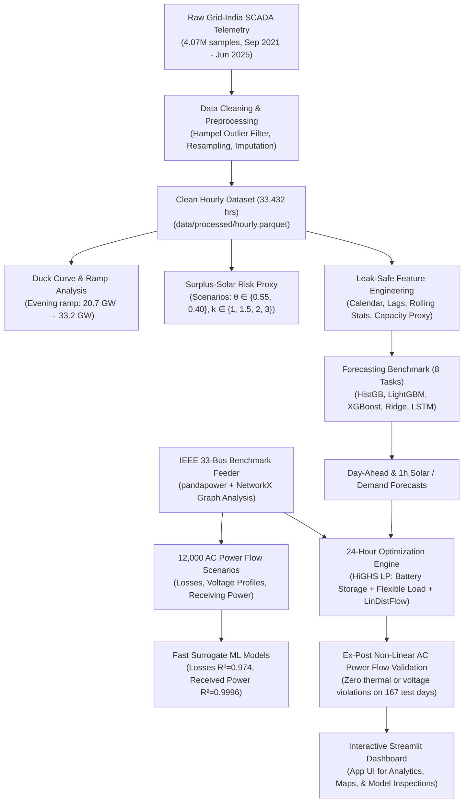

# Short-Term Electricity Demand and Solar Generation Forecasting for Grid Stability

[](https://www.python.org/)
[](https://www.pandapower.org/)
[](https://highs.dev/)
[](https://streamlit.io/)
[](tests/)
[](https://data.mendeley.com/datasets/y58jknpgs8/2)

An end-to-end machine learning and power systems engineering framework for short-term renewable forecasting, duck-curve mitigation, surrogate loss modeling, and forecast-informed battery storage optimization.

---

## ⚡ Executive Summary

As renewable penetration increases, national power grids face dramatic ramping challenges and local distribution networks confront severe thermal and over-voltage risks. This repository provides an end-to-end framework—**SolarCast-Grid**—that bridges macro-scale transmission telemetry with micro-scale physical feeder stability:

1. **Macro Telemetry & Forecasting:** Resamples and rigorously cleans 4,075,224 raw SCADA telemetry points from Grid-India (Sep 2021 – Jun 2025) into a chronological, leak-safe dataset. It systematically benchmarks machine learning algorithms across 8 distinct tasks (1-hour-ahead and day-ahead solar, demand, wind, and net load).
2. **Duck Curve Dynamics & Risk Estimation:** Quantifies India's evolving duck curve—where the evening 3-hour net-load ramp escalated from 20.7 GW (2023) to **33.2 GW (2025)** and midday net-load minimum shifted permanently from night to 13:00 IST. It introduces an assumption-driven surplus-solar-risk proxy under scaled-up capacity scenarios.
3. **Distribution Grid Simulation:** Models the benchmark IEEE/Baran-Wu 33-bus feeder in `NetworkX` and `pandapower`, analysing 50,751 radial configurations and demonstrating that branch-exchange reconfiguration reduces peak technical losses by 31.1%.
4. **Surrogate ML for Fast Power Flow:** Trains physics-motivated surrogate regression models (HistGradientBoosting and LightGBM) that predict feeder technical losses ($R^2 = 0.974$) and receiving-end power delivery ($R^2 = 0.9996$) on held-out scenario families, verified against non-linear AC power flows.
5. **Forecast-Informed 24-Hour Battery Optimization:** Formulates a daily Linear Program (LP) under LinDistFlow voltage and capacity constraints using the HiGHS solver. When verified through full non-linear AC power flow across 167 held-out test days, the forecast-informed dispatch cuts solar curtailment by **90.5%** (achieving 93.6% of theoretical perfect foresight) and reduces feeder technical losses by **17.0%** with **zero voltage or thermal violations**.

> **Data Provenance Standards:** All artefacts are explicitly tagged as `[OBSERVED]` (cleaned Grid-India SCADA), `[DERIVED]` (mathematical aggregates/ratios), `[FORECAST]` (predictive models), `[SIMULATED]` (pandapower AC power flow on the 33-bus benchmark), or `[OPTIMISED]` (HiGHS LP schedules).

---

## 🏗️ System Architecture



---

## 📊 Benchmark Results

### 1. Forecasting Performance (Chronological Test Set: Jan 2025 – Jun 2025)

Models were tuned exclusively on validation data (Jul 2024 – Dec 2024) and evaluated strictly on out-of-sample test data:

| Task | Horizon | Selected Model | Test MAE (MW) | Test $R^2$ | vs Best Baseline | Key Finding |
|---|---|---|---|---|---|---|
| **Solar Generation** | Day-Ahead (14–37 h) | **HistGradientBoosting** | 1,277 | 0.988 | +1.4% | Diurnal profile stable; weather forecast improves MAE by 10.5% |
| **Solar Generation** | 1-Hour Ahead | **LightGBM** | 559 | 0.998 | +47.0% | Strong short-term lag reactivity |
| **Electricity Demand** | Day-Ahead (14–37 h) | **XGBoost** | 4,631 | 0.887 | +33.9% | Weekly & temperature trend capture |
| **Electricity Demand** | 1-Hour Ahead | **LightGBM** | 1,427 | 0.989 | +67.6% | Dominates persistence baselines |
| **Wind Generation** | Day-Ahead (14–37 h) | **Ridge** | 2,040 | 0.783 | +24.3% | Linear regularisation handles low auto-correlation |
| **Wind Generation** | 1-Hour Ahead | **LightGBM** | 389 | 0.992 | +36.5% | Near-term wind persistence capture |
| **Net Load** | Day-Ahead (14–37 h) | **XGBoost** | 6,488 | 0.830 | +16.6% | Direct model out-performs component subtraction |
| **Net Load** | 1-Hour Ahead | **LightGBM** | 2,016 | 0.982 | +67.7% | Critical for real-time dispatch decisions |

*Note: Gradient-boosted decision trees outperformed the deep LSTM sequence model across all operational tabular configurations.*

---

### 2. Grid Optimization & AC Validation (167 Held-Out Test Days)

Every schedule produced by the forecast-informed LP was re-simulated using full non-linear AC Newton-Raphson power flow on the 33-bus network:

| Performance Metric | Baseline (No Control) | Rule-Based Heuristic | Forecast-Informed LP | Perfect Foresight (Upper Bound) |
|---|---|---|---|---|
| **Solar Curtailment (MWh)** | 967.9 | 578.8 (−40.2%) | **91.7 (−90.5%)** | 41.6 (−95.7%) |
| **Solar Utilization (%)** | 86.4% | 91.9% | **98.7%** | 99.4% |
| **Technical Losses (MWh)** | 403.3 | 392.0 (−2.8%) | **334.9 (−17.0%)** | 336.8 (−16.5%) |
| **Mean Daily Peak Import (MW)** | 2.67 | 2.61 (−2.2%) | **2.02 (−24.3%)** | 1.98 (−26.0%) |
| **Mean Evening 3-Hour Ramp (MW)** | 1.95 | 1.76 (−9.8%) | **1.45 (−25.6%)** | 1.47 (−24.4%) |
| **Voltage Violations (Hours)** | 0 | 0 | **0** | 0 |
| **Thermal Violations (Hours)** | 0 | 0 | **0** | 0 |

**Key Takeaway:** The forecast-informed LP recovers **93.6%** of the curtailment reduction attainable under theoretical perfect foresight while maintaining 100% grid compliance with zero constraint relaxation.

---

## 📁 Repository Structure

```
.
├── app/
│   ├── app.py                     # Streamlit multi-page interactive dashboard
│   ├── data_access.py             # Cached data loaders, model inference wrappers
│   └── styles.css                 # Custom styling
├── data/
│   ├── processed/
│   │   └── hourly.parquet         # Cleaned, resampled 33,432-hour SCADA dataset
│   └── raw/                       # Source spreadsheets (downloadable via script)
├── docs/                          # Comprehensive technical documentation
│   ├── PROJECT_SPEC.md            # Mathematical formulation & problem specification
│   ├── DATA_AUDIT.md              # Quality metrics and integrity verification
│   ├── DATA_PIPELINE.md           # Step-by-step cleaning and imputation rules
│   ├── MODEL_METHODOLOGY.md       # Model architectures, tuning, and loss functions
│   ├── MODEL_EVALUATION.md        # Residuals, calibration, and ablation studies
│   ├── GRID_MODEL.md              # IEEE 33-bus feeder parameterization
│   ├── OPTIMIZATION_METHODOLOGY.md# LinDistFlow formulation and LP objective
│   ├── FINAL_RESULTS.md           # Consolidated quantitative findings
│   └── FINAL_REPORT.md            # Full academic project report
├── models/                        # Serialised trained estimators (LightGBM, HistGB, XGB)
├── results/                       # CSV tables, metrics, and generated figures
│   ├── eda/                       # Duck curve plots, correlation matrices, surplus scenarios
│   └── grid_scenarios/            # Feeder topology graphs and loss tables
├── scripts/                       # Reproduction CLI executables
│   ├── download_data.py           # Automated Mendeley Data fetcher (SHA-256 verified)
│   ├── build_dataset.py           # Raw SCADA ingestion and hourly resampling
│   ├── run_eda.py                 # Exploratory data analysis generation
│   ├── run_baselines.py           # Naive, seasonal, and persistence baselines
│   ├── train_models.py            # Model training across all 8 prediction tasks
│   ├── evaluate_models.py         # Test set evaluation and metric compilation
│   ├── run_grid_analysis.py       # Graph topology analysis and feeder reconfiguration
│   ├── run_receiving_power.py     # 12k AC power flows and surrogate loss fitting
│   └── run_optimization.py        # 24-hour LP dispatch and AC validation batch runner
├── src/                           # Core source library
│   ├── analysis/                  # Duck curve metrics, surplus proxy estimation
│   ├── data/                      # SCADA loaders, cleaners, weather fetcher
│   ├── evaluation/                # Metrics (MAE, RMSE, MAPE, MASE, conformal intervals)
│   ├── features/                  # Issue-time aware feature engineering
│   ├── grid/                      # Benchmark feeder definitions and NetworkX graph analysis
│   ├── inference/                 # Real-time multi-step forecaster interface
│   ├── models/                    # Regressors, LSTM sequence model, baseline wrappers
│   ├── optimization/              # LinDistFlow LP builder, battery models, dispatch solver
│   ├── power_flow/                # pandapower AC runner and boundary validator
│   └── simulation/                # Stochastic solar and load scenario generators
├── tests/                         # Comprehensive pytest verification suite (40 unit/integration tests)
├── Project_Report.docx            # Detailed academic project report (Word document)
├── Project_Report.pdf             # Detailed academic project report (PDF document)
├── requirements.txt               # Pinned Python package dependencies
└── README.md                      # Project documentation
```

---

## 🚀 Quick Start

### 1. Prerequisites
- Python 3.10 or 3.11
- Operating System: Windows, Linux, or macOS

### 2. Environment Setup
```bash
# Clone the repository
git clone https://github.com/PiyushAgrawal626/Short-Term-Electricity-Demand-and-Solar-Generation-Forecasting-for-Grid-Stability.git
cd Short-Term-Electricity-Demand-and-Solar-Generation-Forecasting-for-Grid-Stability

# Create and activate virtual environment
python -m venv .venv
# On Windows:
.venv\Scripts\activate
# On Linux/macOS:
source .venv/bin/activate

# Install dependencies
pip install -r requirements.txt
```

### 3. Launch Interactive Dashboard
The processed dataset, trained models, and simulation results are tracked in the repository, so the dashboard runs immediately without retraining:
```bash
python -m streamlit run app/app.py
```

### 4. Run Test Suite
Verify that all unit and integration tests pass:
```bash
python -m pytest -q
```

---

## 🔁 Full Pipeline Reproduction

To reproduce the study from the raw source files:

```bash
# 1. Download raw SCADA spreadsheets (748 MB, Mendeley y58jknpgs8 v2, CC BY 4.0)
python scripts/download_data.py

# 2. Audit raw files and verify schemas
python scripts/audit_raw.py

# 3. Clean raw records, resample to hourly, and build processed parquet
python scripts/build_dataset.py

# 4. Generate EDA figures, duck-curve metrics, and surplus proxy scenarios
python scripts/run_eda.py

# 5. Compute naive and persistence baselines
python scripts/run_baselines.py

# 6. Train all forecasting models (Ridge, HistGB, LightGBM, XGBoost, LSTM)
python scripts/train_models.py

# 7. Evaluate forecasts on chronological test set
python scripts/evaluate_models.py

# 8. Run feeder graph analysis and evaluate reconfigurations
python scripts/run_grid_analysis.py

# 9. Execute 12,000 AC power flows and fit surrogate loss models
python scripts/run_receiving_power.py

# 10. Run forecast-informed LP battery dispatch with AC power flow validation
python scripts/run_optimization.py
```

---

## 🔮 Future Roadmap & Decentralized Energy (Web3)

As power grids transition toward distributed energy resources (DERs), peer-to-peer (P2P) renewable microgrids, and local energy communities, transparent coordination is critical:
- **Decentralized Settlement & Smart Contracts:** Future extensions of this project explore deploying forecast-informed battery dispatch on-chain. Using web3 developer platforms like [thirdweb](https://thirdweb.com), smart contracts can automate local energy settlement, execute transparent curtailment compensation, and issue verifiable Energy Attribute Certificates (EACs) or carbon credits grounded in physical SCADA telemetry.
- **Dynamic Tariff Oracles:** Coupling real-time net-load forecasts with decentralized price oracles to incentivize demand response during steep duck-curve ramping events.

---

## 📚 Data Attribution & References

- **SCADA Telemetry:** Mukherjee D., Kalita K., Kumar S. (2025). *Electricity Demand, Solar and Wind Generation Data (September 2021- June 2025) of India at 1-hour interval*. Mendeley Data, V2. [doi:10.17632/y58jknpgs8.2](https://doi.org/10.17632/y58jknpgs8.2). Licensed under CC BY 4.0. Data sourced from NERLDC, Grid-India.
- **Benchmark Feeder:** Baran, M. E., & Wu, F. F. (1989). *Network reconfiguration in distribution systems for loss reduction and load balancing*. IEEE Transactions on Power Delivery, 4(2), 1401-1407.
- **AC Power Flow Engine:** Thurner et al. (2018). *pandapower—an open-source python tool for convenient modeling, analysis, and optimization of electric power systems*. IEEE Transactions on Power Systems, 33(6), 6510-6521.
- **Optimization Solver:** Huangfu, Q., & Hall, J. A. J. (2018). *Parallelizing the dual revised simplex method*. Mathematical Programming Computation, 10(1), 119-142 (HiGHS solver via PuLP).

---

## 📄 License & Contact

This project is licensed under the MIT License - see the LICENSE file for details.  
Developed by **Piyush Agrawal**. For inquiries or collaboration, please open an issue in this repository.
